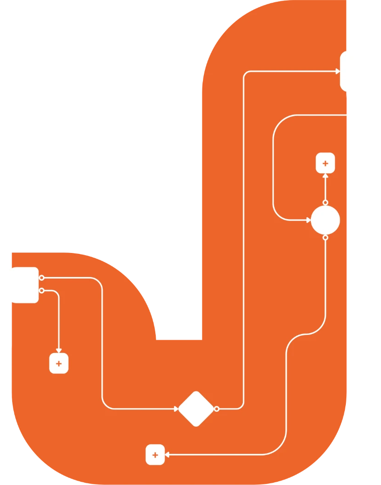

  

<h1 align="center">Hi, I’m Jom 👋</h1>

  I automate repetitive tasks with <b>Zapier</b>, <b>n8n</b>, and <b>AI</b>, so the busywork runs itself and you get up to <b>60 hours a month</b> back.

  <a href="https://jomvill.github.io/personal-portfolio/"><b>→ See my portfolio</b></a>
  &nbsp;·&nbsp;
  <a href="mailto:jomarivillanueva83@gmail.com">Email me</a>
  &nbsp;·&nbsp;
  <a href="https://www.linkedin.com/in/jomari-francis-villanueva-63a5a1aa/">LinkedIn</a>

---

## What I do

I build AI automations that sit between the tools a team already uses. AI does the reading, sorting, and drafting. A person approves what matters. Nothing important moves without a human in the loop.

Before going independent, I led technology and research at **Future AI Lab / BrandNat** (2022–2026), building AI workflows, agents, and automation pipelines. I’m also an Assistant Professor at MSU-IIT, Head of PCETT, and an AI READY ASEAN Master Trainer, based in Iligan City, Philippines.

## Featured workflow: Daily Story Scout

**Your best stories, found and scored every morning.** It pulls stories from Hacker News, Reddit, and the web, AI scores each one, and you tap Keep or Kill in Slack. Kept stories go straight to a script writer, and your votes teach the AI what you like.

[See how it works →](https://jomvill.github.io/personal-portfolio/work/content-pipeline-1-daily-story-scout-score-and-vote/)

## More workflows I’ve built

| Workflow                                                                                                                                  | What it does                                                                                     |
| ----------------------------------------------------------------------------------------------------------------------------------------- | ------------------------------------------------------------------------------------------------ |
| [A story in, a ready-to-film script out](https://jomvill.github.io/personal-portfolio/work/content-pipeline-2-content-package-generator/) | AI writes a research brief, a script with hook and captions, reviews it, and saves it to Notion. |
| [An AI that learns your taste](https://jomvill.github.io/personal-portfolio/work/content-pipeline-3-weekly-preference-learning/)          | Every Sunday, AI studies your Keep and Kill votes and suggests better scoring rules.             |
| [Partnership inquiries, handled end to end](https://jomvill.github.io/personal-portfolio/work/partnership-operations-automation/)         | AI screens every inquiry, you approve, and the CRM, contract, and invoice follow.                |
| [Every email reaches the right team](https://jomvill.github.io/personal-portfolio/work/ai-email-classifier/)                              | AI reads incoming mail and routes it to support, billing, or general.                            |
| [Won deals invoice themselves](https://jomvill.github.io/personal-portfolio/work/create-invoice-from-hubspot-to-quickbooks/)              | When a deal closes, the invoice is created and finance is notified.                              |

[All 12 workflows →](https://jomvill.github.io/personal-portfolio/work/)

All workflows are built in Zapier and can be replicated in n8n.

## Tools I build with

Zapier · n8n · OpenAI · Claude · Perplexity · HubSpot · Slack · Gmail · Google Sheets · Google Apps Script · Airtable · Notion · Obsidian · Feedly · QuickBooks · Trello · ClickUp · Buffer

## Let’s talk

Got a task that eats your week? Tell me what it is, and I’ll say honestly if it’s worth automating.

📧 [jomarivillanueva83@gmail.com](mailto:jomarivillanueva83@gmail.com) · 💼 [LinkedIn](https://www.linkedin.com/in/jomari-francis-villanueva-63a5a1aa/) · 🎓 [Academic work](https://jomvill.github.io/personal-portfolio/academic/)

---

This repository is the source of the portfolio site. Development notes: [docs/DEVELOPMENT.md](docs/DEVELOPMENT.md).
